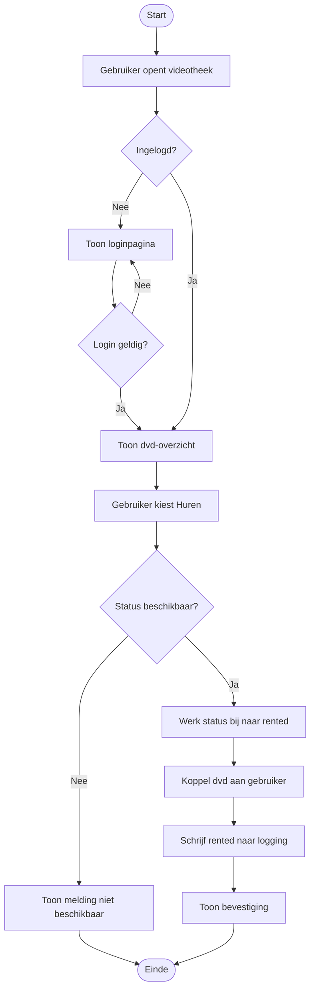

# Stroomschema: dvd huren

## Uitleg

1. De bezoeker opent de videotheek.
2. Alleen ingelogde gebruikers mogen de collectie bekijken.
3. Na een geslaagde login verschijnt het dvd-overzicht.
4. De gebruiker kiest een beschikbare dvd en klikt op **Huren**.
5. De server controleert opnieuw de status in de database.
6. Bij een vrije dvd wordt de status `rented` en wordt de gebruiker gekoppeld.
7. De actie wordt samen met gebruiker en tijdstip in `logging` opgeslagen.
8. De gebruiker krijgt een bevestiging; bij een bezette dvd krijgt hij een foutmelding.
